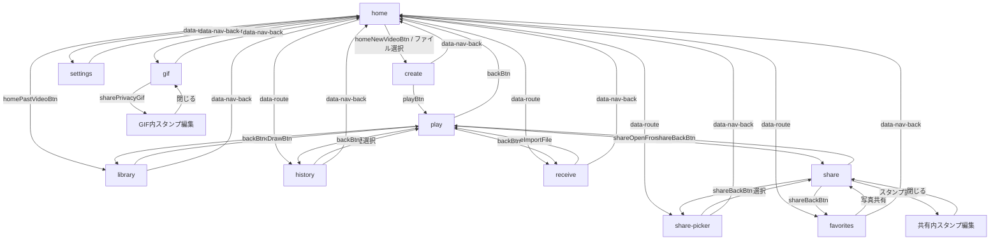

# 画面遷移の監査（暫定）

対象: main `23d15e81089b23939d6215f5a9c7bc6ae2a84e5b`。静的読解による候補であり、実行結果は test-report.md を参照。PR #52 の修正は HEAD に含まれる。

| 入口 / 操作 | 期待先と戻り先 | 状態・検証 |
|---|---|---|
| home / 新しい動画 | create、処理後 play、戻る home | 動画と作成内容 N16 |
| home / 過去の動画 | library、選択後 play、戻る library | 選択元 N09, S02 |
| home / 履歴 | history、選択後 play、戻る history | 履歴の対象 N08 |
| home / お気に入り | favorites、共有後 share、戻る favorites | 写真と形式 N11 |
| home / GIF | gif、編集は gif 内、戻る home | 選択・速度・編集中マスク N01–N05 |
| home / 共有 | share-picker、選択後 share、戻る share-picker | 対象・停止位置 N06–N07 |
| home / 受取 | receive、読込後 play、戻る receive | 一時データ N10, S09 |
| home / 設定 | settings、戻る home | 永続データ S20 |
| play / 共有 | share、戻る play、playから元画面 | 再生文脈 N08–N10 |
| 共有 / 形式・スタンプ | share内エディタ・出力ダイアログ | ファイル本体 N12–N14 |
| ブラウザ履歴 / hash | hashの画面へ | 戻り先はメモリ変数、再読込や履歴往復を要確認 N15, S13, S15 |

README・表示文言・実動作の比較、全イベントと検証済み遷移辺の網羅は未完了。複数の `data-app-view=play` セクションが同じ画面を構成するため、主画面の一意性はルート単位で検査する。
