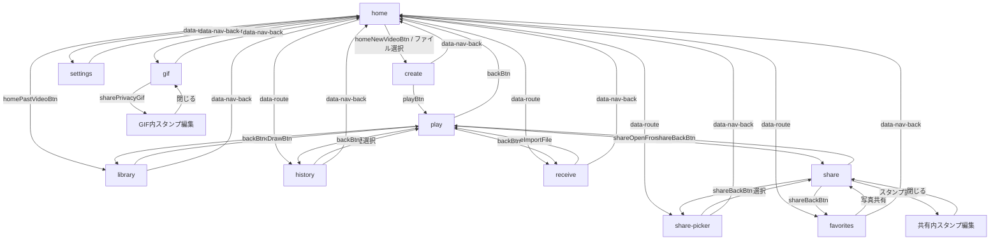

# 画面遷移の監査（暫定）

対象: main `23d15e81089b23939d6215f5a9c7bc6ae2a84e5b`。静的読解による候補であり、実行結果は test-report.md を参照。PR #52 の修正は HEAD に含まれる。

| 入口 / 操作 | 期待先と戻り先 | 状態・検証 |
|---|---|---|
| home / 新しい動画 | create、処理後 play、戻る home | 動画と作成内容 N16 |
| home / 過去の動画 | library、選択後 play、戻る library | 選択元 N09, S02 |
| home / 履歴 | history、選択後 play、戻る history | 履歴の対象 N08 |
| home / お気に入り | favorites、共有後 share、戻る favorites | 写真と形式 N11 |
| home / GIF | gif、編集は gif 内、戻る home | 選択・速度・編集中マスク N01–N05 |
| home / 共有 | share-picker、選択後 share、戻る share-picker | 対象・停止位置 N06–N07 |
| home / 受取 | receive、読込後 play、戻る receive | 一時データ N10, S09 |
| home / 設定 | settings、戻る home | 永続データ S20 |
| play / 共有 | share、戻る play、playから元画面 | 再生文脈 N08–N10 |
| 共有 / 形式・スタンプ | share内エディタ・出力ダイアログ | ファイル本体 N12–N14 |
| ブラウザ履歴 / hash | hashの画面へ | 戻り先はメモリ変数、再読込や履歴往復を要確認 N15, S13, S15 |

README・表示文言・実動作の比較、全イベントと検証済み遷移辺の網羅は未完了。複数の `data-app-view=play` セクションが同じ画面を構成するため、主画面の一意性はルート単位で検査する。

空DB起動時に取得した91件の操作要素は `empty-db-controls.json` に列挙した。初期状態のDOMからの列挙で、履歴カード等のデータ依存の動的操作や全遷移辺を網羅するものではない。完全な辺の分母と網羅率は未確定。

`event-registration-index.txt` は対象JavaScript・HTML内のイベント登録を静的に列挙した127行の索引である。動的に生成される要素や委譲されたイベントは実行条件の分析が必要で、索引の行数をテスト済み遷移数とは扱わない。今回の探索はホームと7画面の往復14辺、および受信・再生・共有を含む6辺を実行したが、全辺の分母はまだ確定していない。

## 主ルートの辺と検証対応

下表は画面ルート間の**31種類の有向辺**に限定したモデル。各辺の少なくとも一例を実ブラウザで確認した（31/31）。各ボタンの全状態・履歴操作・ダイアログ内操作の網羅率を示すものではない。表示ルートと入力・出力・保存データまでを含めた各ケースの結果は別途 `test-report.md` を参照。

| 遷移元 | 遷移先 | 主な確認 |
|---|---|---|
| home | create | N16: 合成動画入力時の中間ルートを記録 |
| create | home | N18: 直接アクセスからアプリ内戻る |
| home ↔ library | 各方向 | 固定seed探索 |
| home ↔ favorites | 各方向 | 固定seed探索 |
| home ↔ history | 各方向 | 固定seed探索 |
| home ↔ settings | 各方向 | 固定seed探索 |
| home ↔ gif | 各方向 | 固定seed探索・N15 |
| home ↔ share-picker | 各方向 | 固定seed探索 |
| home ↔ receive | 各方向 | 固定seed探索 |
| create → play | 再生 | N16 |
| library → play | 再生 | N09 |
| history → play | 再生 | N08 |
| receive → play | 再生 | N10 |
| play → home | ホーム | S17 |
| play → library | ライブラリ | N09 |
| play → history | 履歴 | N08 |
| play → receive | 受信 | N10 |
| play → share | 共有 | N10 |
| share-picker → share | 共有 | N06 |
| favorites → share | 共有 | N11 |
| share → play | 再生 | N08〜N10 |
| share → share-picker | 対象選択 | N07 |
| share → favorites | お気に入り | N11 |
| share → home | ホーム | N18: 対象なしの直接アクセスから戻る |

## README・画面文言・実動作の照合

| 対象 | README / 画面の説明 | 今回のブラウザ検証 |
|---|---|---|
| 受信 | READMEは一時再生し受信画面へ戻ると説明。画面は既存デッキ・履歴へ自動保存しないと説明 | N10で経路、既存履歴内容とストア件数を確認 |
| 共有から戻る | READMEは再生画面と再生元を維持すると説明 | N08〜N10で履歴・ライブラリ・受信を確認 |
| GIFと素材分離 | README・GIF画面は素材追加を許可し選択・作成履歴は変更しないと説明 | S04で選択IDと履歴内容の不変、素材追加を確認 |
| GIF速度 | README・画面は5段階でプレビューと保存が共通と説明 | S03でプレビュー時間とGIFの遅延を比較 |
| GIF動画名検索 | GIF画面は「日付・動画名で検索」と案内 | S02で保存済みファイル名が検索に一致せずFAIL |
| 旧履歴からGIF | READMEは保存画像が2枚以上必要と説明 | S07で1枚の旧履歴は除外され、画面が不足理由を示さずFAIL |
| GIF取込エラー | 計画書は失敗時に原因を表示し、保存済みデータを保持することを要求 | S18で模擬容量不足が形式確認の案内になりFAIL。履歴は保持 |
| 形式とスタンプ | READMEは動画・遊べるファイル・写真、スタンプOFF時は元画像から生成と説明 | N12/N14で合成素材の実ファイルを検査。実端末・外部送信は未確認 |
